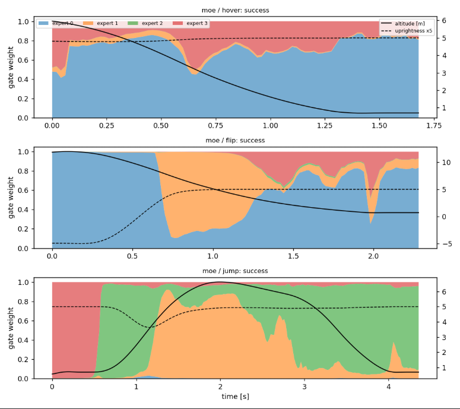
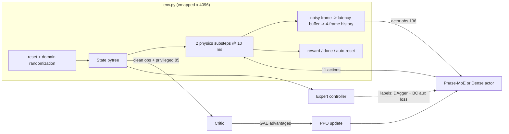
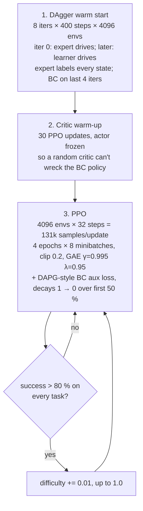

# ThrustCar-6D

A reinforcement-learning benchmark written entirely in JAX. The task is to fly a car that has
cold-gas thrusters. It is loosely modeled on the Tesla Roadster gen-2 reveal (2026-10-15): 10
compressed-air thrusters, about 250 kg of air, an upside-down barrel roll, and a jump over five
vehicles.

The environment, the rollouts and the PPO update are all `jit`-compiled and `vmap`-ed, so 4096 cars
simulate in parallel on a single TPU or GPU.

> Tesla has not published the mass, Isp, thrust levels or thruster geometry. Every one of those
> numbers is an assumption, set in `thrustcar/env.py`.



---

## Contents

- [Tasks](#tasks)
- [Repository layout](#repository-layout)
- [Architecture](#architecture)
  - [Environment and physics](#environment-and-physics)
  - [Observations and actions](#observations-and-actions)
  - [Reward](#reward)
  - [Domain randomization](#domain-randomization)
  - [Expert controller](#expert-controller)
  - [Networks](#networks)
  - [Training pipeline](#training-pipeline)
- [Benchmarks](#benchmarks)
- [Quick start](#quick-start)
- [3D replay viewer](#3d-replay-viewer)
- [Configuration reference](#configuration-reference)

---

## Tasks

A task is sampled for every episode (default mix 25 / 35 / 40 %). One policy has to solve all three.

| id | task | start state | success |
|---|---|---|---|
| 0 | **Hover-land** | 3–10 m up, random velocity, tilt and yaw | settle on all 4 wheels upright (tilt < 0.3 rad, \|v_z\| < 0.5 m/s) and stay there 0.3 s |
| 1 | **Inverted flip** | 12 m up, **upside down**, moving forward at about 15 m/s | roll back upright, then land as in hover |
| 2 | **5-vehicle jump** | on the ground at about 22 m/s | clear Cybercab, Cybertruck, Semi, Model Y and Model 3 (shuffled order, randomized heights up to about 4.1 m), then land, staying inside a ±3 m corridor |

An episode fails on any of these:
- **Crash:** the hull touches the ground, the car hits an obstacle, or it lands harder than 3 m/s.
- **Out of bounds (OOB):** the car leaves the corridor or goes too high or too far.
- **Timeout:** 15 s pass without success.

---

## Repository layout

```
thrustcar/
  env.py        6-DOF physics, observations, reward, randomization, vmapped API
  expert.py     hand-built controller: attitude PD, descent guidance, thrust allocation
  agent.py      Phase-MoE actor, dense actor, asymmetric critic, running obs normalization
  train.py      DAgger warm start, then PPO with curriculum; checkpoints + metrics.jsonl
  evaluate.py   first-episode evaluation over N envs: success, failure modes, gas, CVaR
  analyze.py    benchmark table, MoE gate plot, trajectory export for the viewer
results/
  results.md    curated benchmark tables (shown below)
  moe_gates.png gate weights vs. flight phase
viewer/
  template.html three.js replay app (no build step)
  build.py      inlines a trajectories.json into template.html
  index.html    prebuilt viewer with the latency-run trajectories embedded
  replay_*.json trajectory data (compact / full)
```

---

## Architecture



### Environment and physics

`env.py` steps a single car as a pure function. JAX's `vmap` turns it into a batch.

| component | model |
|---|---|
| Rigid body | 4.5 × 2.0 × 1.2 m box, 1800 kg dry plus gas. Quaternion attitude, body-frame Euler equations with the gyroscopic term, semi-implicit Euler integration |
| Timing | `DT` = 10 ms physics, 2 substeps per control step, so control runs at **50 Hz** (20 ms). Episodes last at most 15 s |
| Thrusters | 10 thrusters at fixed body positions. Torque = (r − CoM offset) × F |
| Valves | first-order lag (τ 20–60 ms) plus a 5 % minimum-command deadband |
| Tank | pressure-regulated blowdown. Full thrust while tank pressure is above the regulator setpoint (35 %), then thrust decays with p ∝ mᴺ (polytropic n = 1.2). Isp = 70 s × √T, so cold gas loses efficiency as it expands. Mass flow = F / (Isp·g₀) |
| Wheels | 4 spring-dampers (k = 2e5, c = 1.2e4). Coulomb-like longitudinal and lateral friction, rolling resistance, drive force only when upright and in contact |
| Aero | anisotropic body drag (CdA = 0.6 / 5 / 8 m² for x / y / z) against an Ornstein-Uhlenbeck gust wind field |
| Sensors | gravity vector, gyro (noise plus bias), velocity, altitude and tank-pressure noise |

Thruster layout (body frame: x forward, y left, z up):

| idx | name | position (m) | direction | max force |
|---|---|---|---|---|
| 0, 1 | rear main L/R | (−2.2, ±0.6, 0) | +x (forward) | 8 kN |
| 2–5 | lift FL/FR/RL/RR | (±1.6, ±0.7, −0.3) | +z (up) | 14 kN |
| 6–9 | side FL/FR/RL/RR | (±1.8, ±0.95, 0.1) | ±y (lateral) | 4 kN |

The car weighs about 20 kN and the four lift thrusters give 56 kN in total. That is about 2.8:1
thrust-to-weight, but only while the tank is above the regulator setpoint.

### Observations and actions

**Actor observation:** a 34-dim frame, stacked over the last 4 control steps, giving 136 dims.

| slice | content |
|---|---|
| 0–2 | task one-hot |
| 3 | altitude / 10 |
| 4–6 | world velocity / 10 (noisy) |
| 7–9 | gravity in body frame (noisy) |
| 10–12 | gyro / 3 (noise + bias) |
| 13–16 | sin/cos yaw, lateral offset y / 5, tank pressure |
| 17–27 | previous action. Never delayed: the controller knows its own last command |
| 28–32 | next obstacle start/end, its height, max remaining height, distance to last obstacle |
| 33 | t / 15 |

Sensor latency comes from an 8-slot ring buffer of raw frames. The actor sees the frame from
`latency` control steps ago, which is 0–100 ms at difficulty 1.0 and up to about 140 ms at the
1.5 stress level.

**Critic observation (85 dims)** is asymmetric. It gets the clean, noise-free, undelayed 34-dim
frame plus 51 privileged dims: the true mass, per-thruster thrust scale, Isp, valve lags, CoM
offset, wind mean and gust, gyro bias, friction, latency, actual valve states, gas, and curriculum
difficulty. The actor never sees these.

**Action (11 dims, range [−1, 1]):** 10 valve commands, mapped to `u = (a+1)/2` with a deadband
below 0.05, plus 1 wheel throttle.

### Reward

The reward is potential-based shaping plus sparse terminal terms:

```
Φ = 3·uprightness − |v_z| / (1 + z)          (sink term only while airborne)
r = ΔΦ
  + 0.05·Δx                                   (jump: forward progress)
  + 10 per obstacle cleared
  − 0.002·Σu − 0.02·‖a − a_prev‖²             (gas use, action smoothness)
  + success · (100 + 50·gas_fraction)         (rewards saving air)
  − crash   · (100 + 30·excess impact speed)
  − 50 on OOB / timeout
```

PPO scales the reward by 0.1.

### Domain randomization

Every reset samples new vehicle parameters. The spread grows with `difficulty`:
`s = 0.25 + 0.75·d`, so d = 0 gives a quarter of the full spread, d = 1 the full spread, and
d = 1.5 is the out-of-distribution stress test.

| parameter | range at d = 1 |
|---|---|
| mass | ±15 % |
| thrust, per thruster | ±15 % (independent) |
| Isp | ±10 % |
| valve lag τ, per thruster | 20–60 ms |
| CoM offset | ±0.15 m per axis |
| mean wind | ±6 m/s horizontal, ±1.2 m/s vertical; gust σ = 3 m/s |
| gyro bias | σ = 0.02 rad/s |
| tank fill | 85–100 % |
| ground friction μ | 0.7–1.0 |
| sensor latency | 0–5 control steps (0–100 ms) |
| obstacle heights | ±10 %; order shuffled; start x 50–70 m |
| initial conditions | velocity, attitude and spin scale with `s` |

### Expert controller

`expert.py` is a hand-written controller. It uses the **true state** but **nominal** vehicle
parameters, so randomized mass or thrust surprises it. It has two jobs: it is the baseline, and it
is the DAgger teacher.

- **Attitude:** geometric PD on the axis–angle error between the body-up and desired-up vectors
  (Kp = 14, Kd = 6), scaled by inertia. When the car is nearly inverted, it picks a body-x roll
  axis and keeps rolling in the direction the car is already spinning.
- **Vertical guidance:** a braking-burn profile `v_ref = −√(1 + 7h)` for landing. For the jump it
  climbs to the tallest remaining obstacle plus margin, triggered by time-to-obstacle, and coasts
  otherwise.
- **Lateral:** for the jump, it tilts the lift vector to stay centred in the corridor, like a
  quadrotor; side thrusters damp lateral drift.
- **Allocation:** maps the wanted thrust and torques to the 4 lift thrusters and the 4 side
  thrusters. Torque gets priority over lift and is capped to the available authority. The main
  thrusters are unused; the wheels give full throttle on the jump.

### Networks

`agent.py`, built with Flax:

| network | structure | params |
|---|---|---|
| **PhaseMoEActor** | trunk 136 → 256 → 256 (tanh) → softmax gate over K = 4 experts. Each expert is 256 → 256 → 11. Experts run as batched `einsum`, with no Python loop. Mean action = Σ gateₖ · expertₖ. State-independent log-std | ~376 k |
| **DenseActor** (ablation) | 136 → 400 → 400 → 400 → 11 (tanh), parameter-matched to the MoE | ~380 k |
| **Critic** | 85 → 512 → 512 → 512 → 1 (tanh) | ~570 k |

Both observation streams are normalized with running mean and variance (Chan's parallel update),
clipped to ±10.

The MoE adds two regularizers. A **load-balance loss** `K·Σ(mean gate)² − 1` (coef 0.01) stops one
expert from taking over. A per-sample **gate-entropy penalty** (coef 0.003) pushes each state toward
a decisive expert choice. The experts get no phase labels; any specialization they show is learned.

### Training pipeline



Other details:
- After DAgger, `log_std` is reset to −1.6 so exploration stays tight around the imitated policy.
- Adam, lr 1.5e-4 decaying linearly to 1.5e-5, gradient clip 0.5, value clipping.
- The whole update (rollout `scan`, GAE `scan`, epoch/minibatch `scan`) is one `jax.jit` call.
- Every 100 updates the run evaluates 1024 first episodes per task at d = 1.0. It writes
  `last.pkl` every time and `best.pkl` when mean success improves. It logs to `metrics.jsonl`.

---

## Benchmarks

Setup: Colab TPU v5e-1, 200 M env steps per run, 4096 first-episode evaluations per cell.
Each cell is **success % (kg of air left on successful episodes)**. `d` is the randomization
difficulty; 1.5 is out of distribution (the agent trained up to 1.0).

### v1: no sensor latency

| policy | d | hover | flip | jump |
|---|---|---|---|---|
| expert (PD + allocation) | 0.0 | 100.0 (193) | 99.8 (144) | 99.6 (112) |
| expert | 1.0 | 99.0 (171) | 89.8 (113) | 48.1 (86) |
| expert | 1.5 | 92.0 (160) | 77.3 (103) | 28.0 (79) |
| **Phase-MoE PPO** | 0.0 | 100.0 (203) | 100.0 (154) | 100.0 (132) |
| **Phase-MoE PPO** | 1.0 | 99.2 (185) | 99.0 (136) | 97.0 (114) |
| **Phase-MoE PPO** | 1.5 | 92.1 (175) | 86.1 (127) | 80.8 (106) |
| Dense PPO (param-matched) | 0.0 | 100.0 (199) | 100.0 (148) | 100.0 (118) |
| Dense PPO | 1.0 | 99.9 (179) | 98.9 (127) | 99.5 (97) |
| Dense PPO | 1.5 | 98.1 (169) | 85.2 (115) | 86.6 (90) |
| MoE PPO from scratch (no DAgger) | any | 0.0 | 0.0 | 0.0 |

### v2: plus sensor-latency randomization (0–100 ms at d = 1, up to about 140 ms at d = 1.5)

The expert still sees perfect, undelayed state, which favours the expert.

| policy | d | hover | flip | jump |
|---|---|---|---|---|
| expert (no delay) | 1.0 | 99.0 (171) | 89.8 (113) | 48.1 (86) |
| Phase-MoE PPO | 1.0 | 98.7 (176) | 96.6 (123) | 96.9 (94) |
| Dense PPO | 1.0 | 99.3 (177) | 98.6 (126) | 97.7 (96) |
| expert (no delay) | 1.5 | 92.0 (160) | 77.3 (103) | 28.0 (79) |
| Phase-MoE PPO | 1.5 | 80.3 (164) | 65.1 (112) | 64.9 (86) |
| Dense PPO | 1.5 | 82.3 (165) | 70.8 (114) | 69.3 (87) |

### Takeaways

- **Learned policies beat the teacher.** On the jump at d = 1, success goes from the expert's 48 %
  to 97–99.5 %. Under the 1.5× stress test the jump goes from 28 % to 81–87 %, even though the
  agents never trained past d = 1.
- **The DAgger warm start is required.** PPO from scratch reaches 0 % in 200 M steps: random
  valve-firing almost never finds a landing. Imitation plus a decaying BC loss is what makes PPO
  work here.
- **MoE vs dense: no clean win yet.** The MoE saves 6–17 kg more air. The dense actor is about
  2.5 points more reliable on the jump and more robust at d = 1.5.
- **The experts specialize by flight phase without labels** (figure above). On the jump the gate
  moves through drive → climb → apex/coast → descent/landing experts.
- **Latency hurts most under stress.** With up to 140 ms of delay, learned success at d = 1.5 drops
  by 12–21 points. It falls below the undelayed expert on hover and flip, but still more than
  doubles the expert's success on the jump (65–69 % vs 28 %).

---

## Quick start

Requirements: Python 3.10+, `jax` (with a TPU/GPU backend for real runs), `flax`, `optax`, `numpy`,
and `matplotlib` (analysis only).

```bash
pip install -U "jax[cuda12]" flax optax numpy matplotlib     # or jax[tpu] / plain jax for CPU

# train (defaults: 4e8 steps; the benchmark above used --total-steps 2e8)
python -m thrustcar.train --actor moe   --out runs/moe
python -m thrustcar.train --actor dense --out runs/dense     # param-matched ablation

# no-DAgger ablation
python -m thrustcar.train --actor moe --dagger-iters 0 --out runs/moe_scratch

# benchmark table + gate plots + trajectories
python -m thrustcar.analyze --runs runs/moe runs/dense --out results
```

Each run directory holds `config.json`, `metrics.jsonl` (training and eval logs), `last.pkl` and
`best.pkl`. `analyze` loads `best.pkl` from each run and writes these to `--out`:
- `results.md` and `results.json`: success, gas, CVaR-5 % return, crash and OOB rates per
  policy × difficulty × task. This **overwrites** the curated `results/results.md`, so point
  `--out` somewhere else to keep it.
- `gates_<run>.png`: the gate plot.
- `trajectories.json`: input for the viewer.

To use the environment on its own:

```python
import jax, jax.numpy as jnp
from thrustcar import env as E, expert as X

st = E.v_reset(jax.random.split(jax.random.PRNGKey(0), 1024), 1.0, jnp.array([.25, .35, .4]), None)
step = jax.jit(lambda st: E.v_step(st, X.v_expert(st)))
st, reward, done, info = step(st)          # auto-resets finished envs
```

---

## 3D replay viewer

`viewer/index.html` is a self-contained three.js page. Open it in a browser; there is no server or
build step. It shows a chosen policy flying each task and can overlay an **expert ghost** that
starts from the same seed. The panels show valve openings, gas, the outcome, and the MoE gate
weights over time. Use Space to play/pause, change the speed, scrub the timeline, or load another
`trajectories.json` from the page.

To rebuild it with your own trajectories:

```bash
python viewer/build.py results/trajectories.json viewer/index.html
```

---

## Configuration reference

The main `train.py` flags (`python -m thrustcar.train -h` lists all of them):

| flag | default | meaning |
|---|---|---|
| `--actor` | `moe` | `moe` or `dense` |
| `--n-experts` | 4 | MoE experts K |
| `--num-envs` / `--num-steps` | 4096 / 32 | parallel envs / rollout length per update |
| `--total-steps` | 4e8 | PPO env steps |
| `--lr` | 1.5e-4 | Adam lr (linear decay to 10 %) |
| `--gamma` / `--lam` | 0.995 / 0.95 | discount / GAE λ |
| `--lb-coef` / `--gate-ent-coef` | 0.01 / 0.003 | MoE load-balance / gate-entropy weights |
| `--dagger-iters` | 8 | 0 disables the warm start |
| `--bc-coef` / `--bc-decay-frac` | 1.0 / 0.5 | BC aux loss weight and the fraction of training over which it decays to 0 |
| `--critic-warmup` | 30 | updates with the actor frozen |
| `--curr-thresh` / `--curr-step` | 0.80 / 0.01 | curriculum gate and increment |
| `--task-probs` | `0.25,0.35,0.40` | hover / flip / jump sampling mix |
| `--eval-difficulty` | 1.0 | difficulty for periodic eval |
